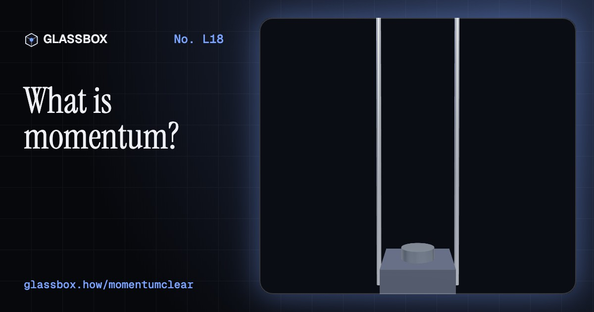
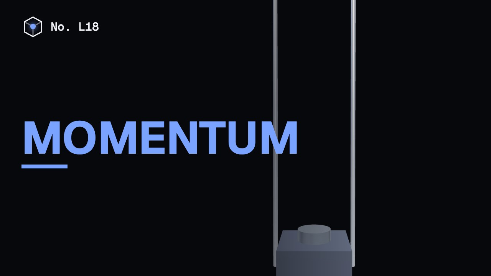
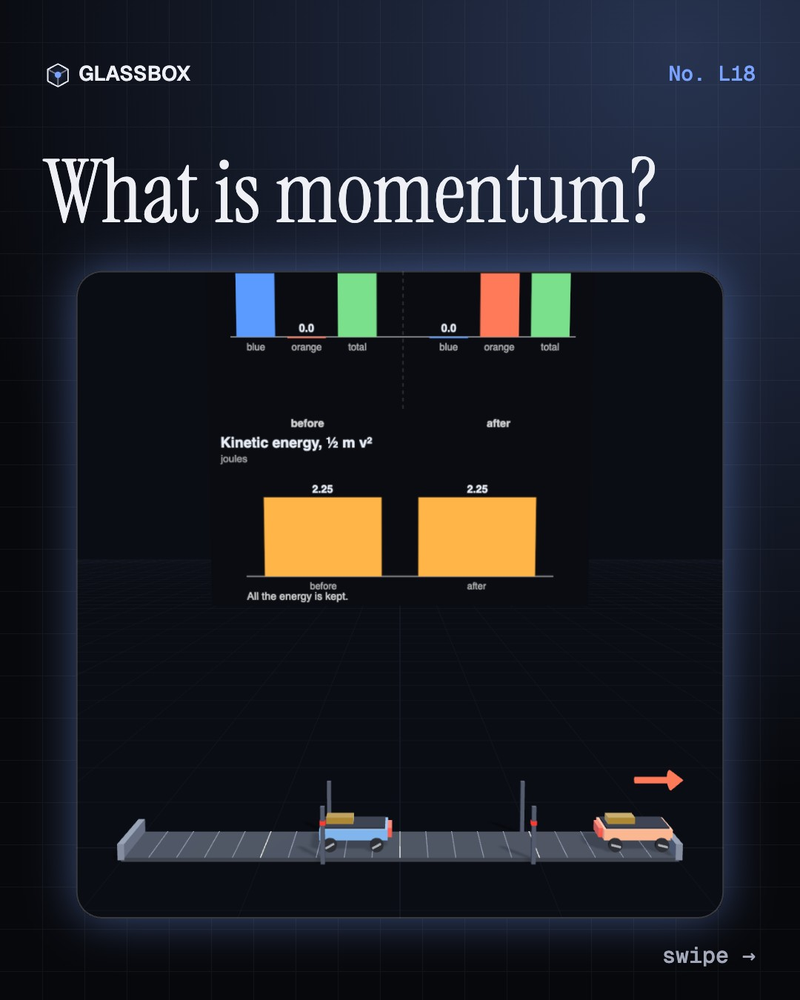
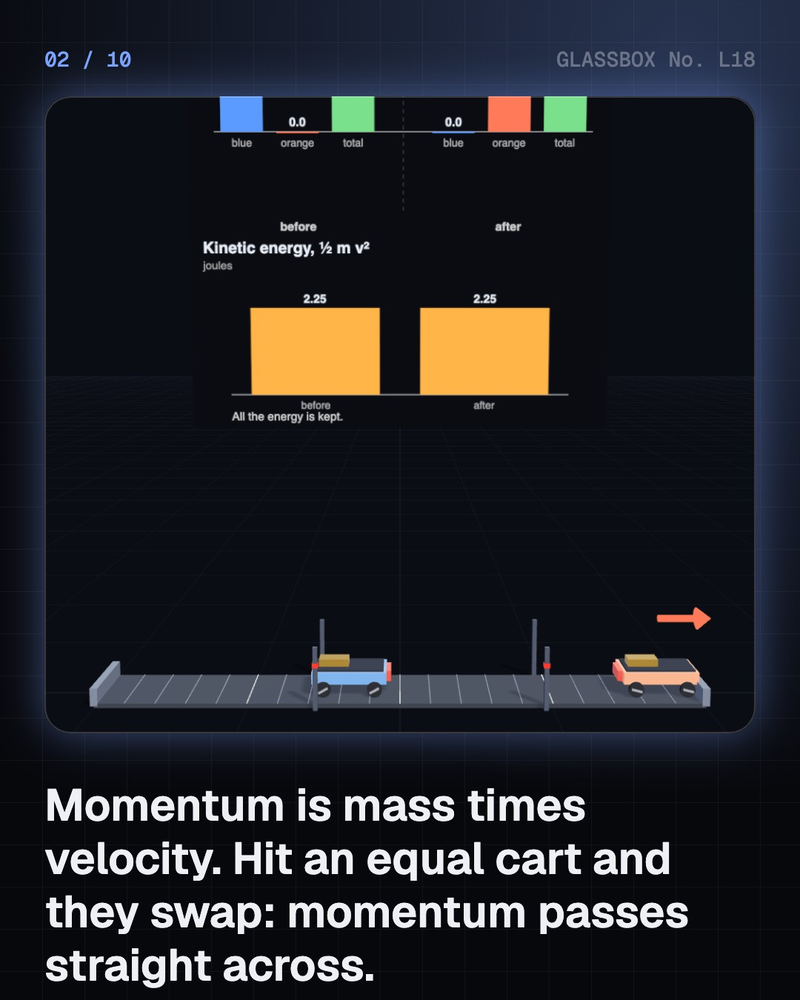
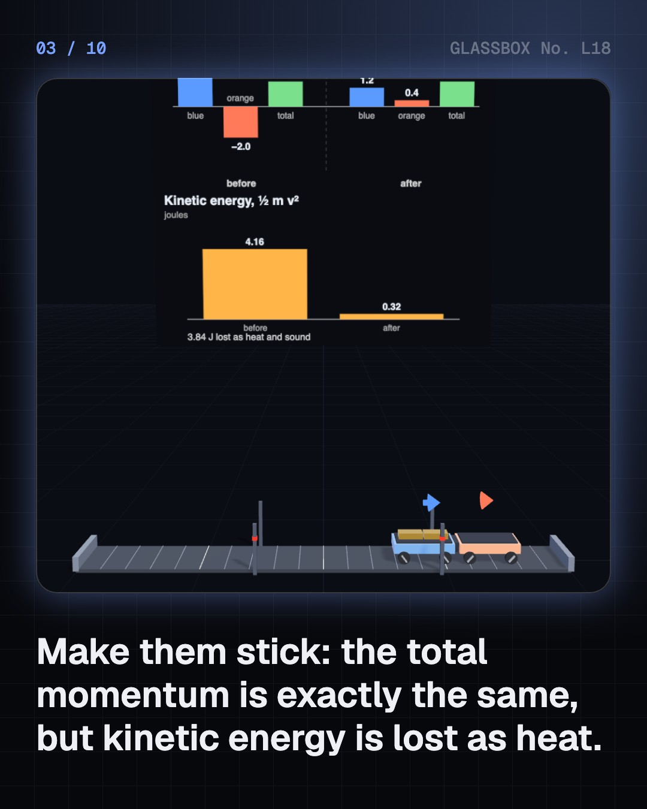
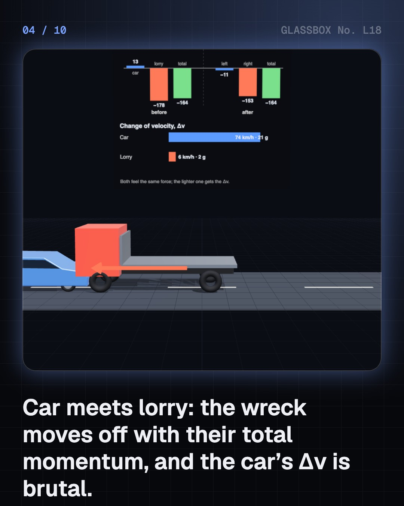

<!-- glassbox:start -->
<!-- Generated from glassbox.json by the Glassbox hub (npm run readme -- momentumclear). Edit glassbox.json, not this block. -->
<p align="center"><a href="https://glassbox-production-fd52.up.railway.app/e/momentumclear/"></a></p>

<h1 align="center">Momentum</h1>

<p align="center"><b>What is momentum?</b><br>Why does a lorry shove a car backwards in a crash, why does a helmet have foam, and why does a Newton's cradle send out exactly two balls when you drop two? Crash carts, cars and carrom strikers, fire a cannon and a rocket, catch a cricket ball, and sail on sunlight.</p>

<p align="center"><a href="https://glassbox-production-fd52.up.railway.app/momentumclear/"><b>▶ Play with it</b></a> &nbsp;·&nbsp; <a href="https://glassbox-production-fd52.up.railway.app/e/momentumclear/">Read the 60-second explainer</a> &nbsp;·&nbsp; <a href="https://glassbox-production-fd52.up.railway.app/momentumclear/glassbox/reel.mp4">Watch the 40-second video</a></p>

<p align="center">
  <a href="https://glassbox-production-fd52.up.railway.app/e/momentumclear/"></a>
  <a href="https://glassbox-production-fd52.up.railway.app/e/momentumclear/"></a>
  <a href="LICENSE"></a>
  <a href="LICENSE-CONTENT.md"></a>
  <a href="#privacy"></a>
</p>

## In 60 seconds

1. **Mass on the move.** Momentum is mass times velocity, p = m v, in kg·m/s, and it has a direction. Measure m on a scale and v with light gates, and multiply. When two carts collide or spring apart, whatever one loses the other gains, so the total is the same before and after: bouncy, sticky or explosive. Kinetic energy is only kept in the bouncy case.
2. **Crashes and catches.** After a head-on crash the wreck moves with the total momentum, so a lorry barely slows while a car's Δv is huge. Stopping anything needs an impulse, F × Δt = Δp. Crumple zones, belts, airbags, helmet foam and soft hands all stretch Δt so the peak force, in g, falls.
3. **Push-offs.** Start at zero momentum and push apart: skaters, a boat and its jumper, a cannon and its ball end with equal and opposite momentum. A rocket keeps throwing exhaust back, Δv = v_e ln(full ÷ empty), and a ceiling fan's thrust is the air's momentum per second, about 13 N.
4. **Games.** Newton's cradle sends out as many balls as you drop, because only that keeps both momentum and energy; clay balls crawl off together. On a carrom board momentum adds as arrows, and equal pool balls split at 90°. A cricket bat reverses the ball's momentum in about a millisecond.
5. **Myths and limits.** In a crash both vehicles feel the same force; the heavier one just changes speed less, and the wreck goes the way of more momentum. Momentum isn't energy: same p, a lighter, faster ball digs a far deeper dent. Spin has its own conserved momentum, L = I ω, and even light pushes: IKAROS, 2010.

## Words worth knowing

| Term | Meaning |
|---|---|
| **Momentum** | Mass times velocity, p = m v, in kg·m/s. It has a size and a direction. |
| **Conservation of momentum** | With no outside push, the total momentum of colliding or exploding objects stays the same. |
| **Impulse** | Force × time, F Δt, in N·s. It equals the change of momentum, so a longer stop means a smaller force. |
| **Elastic and inelastic** | Elastic collisions keep kinetic energy too; inelastic ones turn some of it into heat, sound and dents. |
| **Δv** | The change of velocity in a collision, the best single measure of how much a crash hurts. |
| **Thrust** | The push from throwing mass away: mass per second × speed. Rockets and fans both work this way. |
| **Rocket equation** | Δv = v_e ln(m_full ÷ m_empty), Tsiolkovsky, 1903. |
| **Angular momentum** | The momentum of spinning, L = I ω, also conserved. Light carries momentum too: p = E ÷ c. |

## A short history

**From impetus to solar sails: 1,500 years of learning what a moving thing carries.**

- **1350** · Impetus: quantity of matter times speed (Jean Buridan, University of Paris)
- **1644** · Descartes: the quantity of motion is conserved (René Descartes, Amsterdam, Netherlands)
- **1668** · The Royal Society's collision papers (John Wallis, Christopher Wren and Christiaan Huygens, London, England)
- **1686** · Leibniz: Descartes measured the wrong thing (Gottfried Wilhelm Leibniz, Leipzig, Germany)
- **1687** · Newton makes momentum the heart of mechanics (Isaac Newton, London, England)
- **1903** · Tsiolkovsky's rocket equation (Konstantin Tsiolkovsky, Kaluga, Russia)
- **1959** · Crumple zones reach the road (Béla Barényi, Mercedes-Benz, Sindelfingen, Germany)
- **2010** · IKAROS sails on sunlight (JAXA, Tanegashima, Japan)

The full story, with 21 moments, charts, people and 30 sources: [glassbox.how/e/momentumclear/history](https://glassbox-production-fd52.up.railway.app/e/momentumclear/history/). The data lives in [`history.json`](history.json).

## Video and slides

Made with the Glassbox studio from this box's storyboard (`window.glassbox.director`). Free to reuse under CC BY 4.0.

<a href="https://glassbox-production-fd52.up.railway.app/momentumclear/glassbox/video.mp4"></a>

<p><a href="glassbox/slide-1.jpg"></a> <a href="glassbox/slide-2.jpg"></a> <a href="glassbox/slide-3.jpg"></a> <a href="glassbox/slide-4.jpg"></a></p>

| File | What | Size |
|---|---|---|
| [`glassbox/reel.mp4`](https://glassbox-production-fd52.up.railway.app/momentumclear/glassbox/reel.mp4) | Reel / Short, with captions and soundtrack | 1080×1920 |
| [`glassbox/video.mp4`](https://glassbox-production-fd52.up.railway.app/momentumclear/glassbox/video.mp4) | YouTube video, with captions and soundtrack | 1920×1080 |
| `glassbox/slide-1…10.jpg` | Instagram carousel | 1080×1350 |
| `glassbox/thumb.jpg` | YouTube thumbnail | 1280×720 |
| `glassbox/cover.jpg` | Share card and repo social preview | 1200×630 |
| [`glassbox/history-reel.mp4`](https://glassbox-production-fd52.up.railway.app/momentumclear/glassbox/history-reel.mp4) | “History in 10 moments” Reel / Short | 1080×1920 |
| `glassbox/history-slide-*.jpg` | History carousel | 1080×1350 |
| `glassbox/post.json` | Post copy and schedule used by the publish kit | |

## Privacy

This box has no accounts and no ads, and it ships its own fonts and libraries. When you run it yourself it sends nothing anywhere. On glassbox.how, the site's `/bar.js` also loads Glassbox's analytics: **Google Analytics** to count visits (it asks first in the EU, UK and Switzerland, and stays off when your browser sends Global Privacy Control or Do Not Track) and **ClickTrust** to detect bots.

It remembers a few things **in your own browser only**, and never sends them anywhere:

| Browser storage key | What it holds |
|---|---|
| `momentumclear.v1` | Which chapters you have opened, your best quiz scores, and sound on or off. |

Exactly what each one sees is at [glassbox.how/privacy](https://glassbox-production-fd52.up.railway.app/privacy/).

## Licences

- **Code:** [MIT](LICENSE). Use it, change it, ship it.
- **Explanations, text, images and videos** (`glassbox.json`, `glassbox/`): [CC BY 4.0](LICENSE-CONTENT.md). Credit “Glassbox, glassbox.how/e/momentumclear”.
- **Third-party parts** keep their own licences: [three.js](https://threejs.org) (MIT), [Geist, Instrument Serif](https://openfontlicense.org) (SIL OFL 1.1).
- The Glassbox name and logo aren't covered by either licence. See the [terms](https://glassbox-production-fd52.up.railway.app/terms/).

Found a mistake? [Open an issue](https://github.com/bdeeps/momentumclear/issues). Corrections happen in public.
<!-- glassbox:end -->

## Run it

It's plain HTML, CSS and JavaScript. No build step and no dependencies. Run locally, it contacts no other website.

```bash
python3 -m http.server 8000
```

Three.js and the fonts ship in `vendor/` and `fonts/`, so it also works offline.

Then open http://localhost:8000.

## How it's built

| File | What |
|---|---|
| `index.html`, `css/app.css` | The page and its styles |
| `js/app.js`, `js/stage.js`, `js/ui.js`, `js/kit.js` | The shared Glassbox 3D engine: chapters, 3D stage, controls, quiz, video director |
| `js/momentum.js` | Shared parts: momentum and collision maths, force–time pulses, bar-chart boards, and the carts, vehicles, people, cannon, boat, rocket and ceiling fan models |
| `js/chapters/*.js` | One file per chapter: the 3D model, controls, text, key terms, quiz and video scenes |
| `glassbox.json` | Title, question, explainer beats, key terms, browser storage and credits shown on glassbox.how |
| `reel` in each chapter | The storyboard the Glassbox studio records into short videos |
| `glassbox/` | The published video, slides, thumbnail and post copy |
| `fonts/`, `vendor/three/` | Self-hosted Geist and Instrument Serif (SIL OFL 1.1) and three.js (MIT) |
